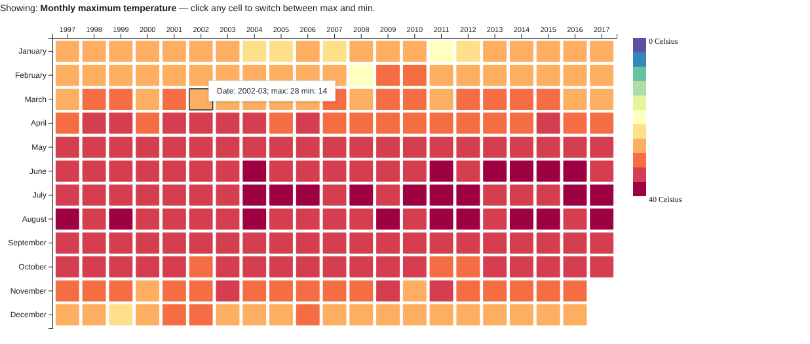
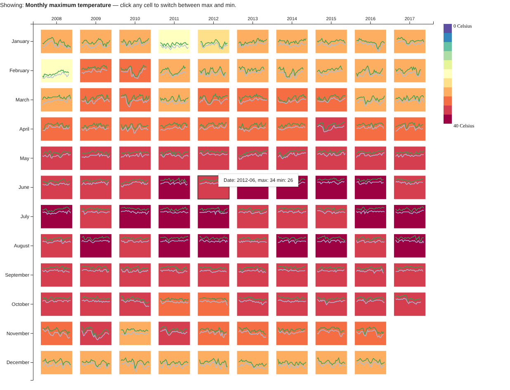

# CSCE 679 Data Visualization — Assignment 1
## Hong Kong Monthly Temperature: Year/Month Matrix View

**Author:** Diviya Bhavaani M B
**UIN:** 137008855
**Course:** CSCE 679 – Data Visualization, Texas A&M University

🔗 **Live demo:** https://diviyabhavaani-mb.github.io/CSCE679-Assignment1/
(No setup needed — open the link and you can hover and click the charts right away.)

---

## Overview

For this assignment I built two interactive matrix views of daily Hong Kong temperatures from 1997 to 2017 using **D3.js (v7)**. Each cell in the matrix is one month of one year: years run left to right along the top, and months run top to bottom down the left side.

| Level 1 — Monthly heatmap (1997–2017) | Level 2 — Last 10 years with daily lines |
|---|---|
|  |  |

---

## How to use the visualization

**Level 1 – Year/Month Heatmap**
- Each cell's color shows that month's **maximum temperature** (the hottest daily high in the month).
- **Click any cell** to switch every cell to the **minimum temperature** (the coldest daily low in the month). Click again to switch back. The line above the chart always tells you which one you're looking at.
- **Hover over a cell** to see the exact values, for example `Date: 2002-03; max: 28 min: 14`.
- The **legend** on the right shows how colors map to temperature: purple/blue at the top is cold (0 °C) and dark red at the bottom is hot (40 °C).

**Level 2 – Heatmap with Daily Temperature Lines (2008–2017)**
- Same layout, colors, hover tooltip and click-to-switch as Level 1, focused on the last 10 years of data.
- Inside each cell there is a small line chart of every day in that month:
  - **Green line** = daily maximum temperature
  - **Light-blue line** = daily minimum temperature
  - Left to right is day 1 to day 31 of the month; higher means warmer.
- All the mini charts share the same temperature scale, so you can compare the lines across months and years directly. For example, winter months clearly show much bigger day-to-day swings than summer months.

---

## Running it on your own computer

The page reads the CSV file in the browser, so it needs to be served through a local web server. Double-clicking `index.html` won't load the data.

1. Clone or download this repository.
2. Open a terminal in the project folder and run:
   ```bash
   python -m http.server 8000
   ```
3. Open **http://localhost:8000** in a browser (Chrome or Edge recommended).

An internet connection is needed the first time, since D3 is loaded from a CDN.

---

## How the code is organized

I split the code into small modules so that each file has one job and both levels can share the same drawing logic.

```
├── index.html            Page layout; loads D3 and js/main.js
├── css/style.css         Page styling (fonts, tooltip box, axis text)
├── data/
│   └── temperature_daily.csv
├── js/
│   ├── config.js         Every setting in one place (sizes, colors, years shown, data path)
│   ├── dataLoader.js     Reads the CSV and groups daily data into months
│   ├── colorScale.js     Maps a temperature to a color (shared by charts and legend)
│   ├── legend.js         Draws the vertical color legend
│   ├── tooltip.js        Reusable hover tooltip
│   ├── miniLineChart.js  Level 2: daily max/min lines inside each cell
│   ├── matrixHeatmap.js  The year/month matrix used by both levels
│   └── main.js           Starting point: loads the data once and draws both levels
└── screenshots/          Images used in this README
```

**Design decisions**
- **One renderer for both levels.** Level 1 and Level 2 both call `renderTemperatureMatrix()`. The only difference is the layout object passed in (`LEVEL1_LAYOUT` vs `LEVEL2_LAYOUT` in `config.js`). Level 2 simply turns on `showDailyLines`.
- **No magic numbers in the drawing code.** Cell sizes, margins, gaps, colors, number of years, legend size and animation speed all live in `config.js`, so changing the look doesn't require touching the drawing logic.
- **Easy to extend.** A few examples:
  - Show 5 years instead of 10 in Level 2 → set `LEVEL2_LAYOUT.yearsToShow = 5`.
  - Bigger cells → change `cellWidth` / `cellHeight`.
  - Different line colors → edit `MINI_LINE_CHART_SETTINGS`.
  - A new view → add a layout object in `config.js` and pass it to `renderTemperatureMatrix()` in `main.js`.

---

## Notes on the data and choices I made

- **Monthly values:** "max" for a month is the highest daily maximum in that month, and "min" is the lowest daily minimum. This matches the tooltip values in the example images (e.g. March 2002 → max 28, min 14).
- **Colors:** I used D3's 11-step *Spectral* color scheme, reversed so cold is purple/blue and hot is dark red, to match the reference images. While comparing my output with the examples, I noticed their color boundaries line up with splitting **0–39 °C** into 11 equal steps (for example, 35 °C is red but 36 °C is dark red). I used that range so the colors match the reference cell for cell, and kept the legend labelled 0–40 °C as in the example.
- **Missing data:** The dataset ends on 2017-10-28, so November and December 2017 are empty. A few days are missing (mostly in 2000). In those months the line just connects the days that exist.
- **One small difference from the example:** the Level 2 reference image shows `min: 28` for April 2012, but the actual lowest temperature in the data for that month is 19 °C, so my tooltip shows 19.

---

## Tools used
- [D3.js v7](https://d3js.org/) for scales, axes, data loading and drawing
- Plain HTML, CSS and JavaScript (ES modules), no build step
- GitHub Pages for hosting the live demo
